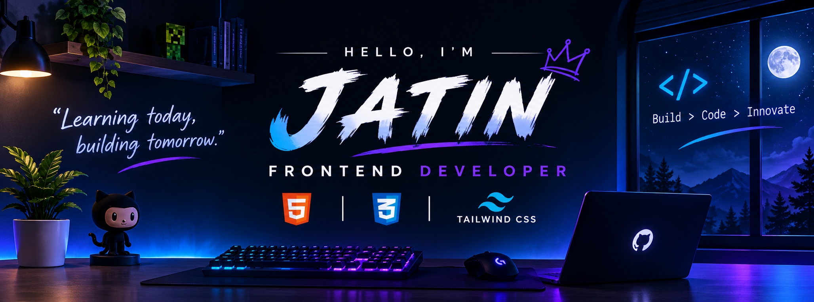

  

 

# Hey, I'm Jatin! 👋

### 💻 Aspiring Frontend Developer

Building beautiful, responsive and user-friendly websites.

---

## 🚀 About Me

- 👨‍💻 Aspiring Frontend Developer.
- 🌱 Currently learning HTML, CSS and Tailwind CSS.
- 🎨 Interested in modern UI design and responsive websites.
- 💡 Love learning new technologies and building projects.
- 🎯 Working towards becoming a professional developer.

---

## 🛠️ Tech Stack

  

---

## 📖 Currently Learning

- HTML5
- CSS3
- Tailwind CSS
- Responsive Web Design
- Git & GitHub

---

## 🎯 My 2026 Goals

- [ ] Master HTML and CSS.
- [ ] Improve Tailwind CSS skills.
- [ ] Learn JavaScript.
- [ ] Learn React.js.
- [ ] Build 10+ frontend projects.
- [ ] Create my personal portfolio.
- [ ] Contribute to open-source projects.

---

## 📊 GitHub Statistics

---

## 💻 Most Used Languages

---

## 🤝 Connect With Me

---

### 💙 Thanks for visiting my profile!

**"Learning today, building tomorrow."**

⭐ From [Jatin](https://github.com/CodeLikeJatin)

